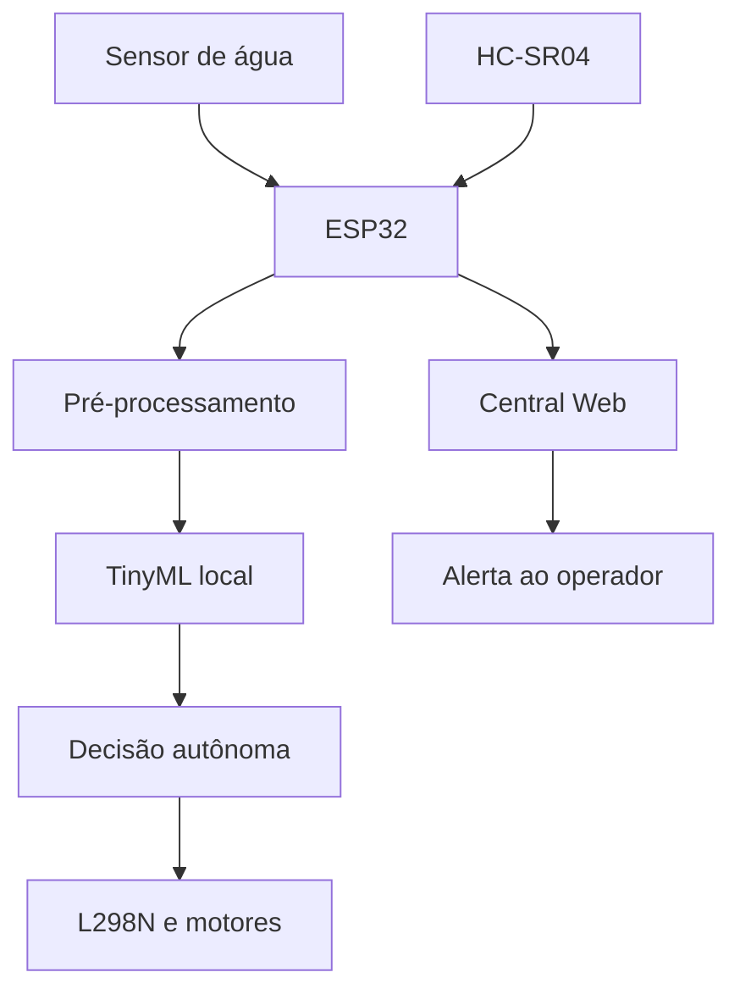

# DrenaHub — DrenaBot 01

> Robô móvel para inspeção preventiva de pontos com acúmulo de água, desenvolvido para a Global Solution **CitizenTech** da disciplina **Project-Based Maker Lab** — FIAP 4ESPY.

## Integrantes

| Nome | RM |
|---|---:|
| Gabriel Machado Carrara Pimentel | 99880 |
| Lourenzo Ramos | 99951 |
| Vitor Hugo Rodrigues | 97758 |

## Vídeo

[**Video Demonstração**](https://www.youtube.com/watch?v=7y7U7v0JTDU)

## O projeto

O **DrenaHub** é uma proposta de monitoramento preventivo de drenagem para condomínios, galpões, estacionamentos, centros logísticos e outras áreas privadas ou públicas. O primeiro dispositivo do ecossistema, o **DrenaBot 01**, evolui o carrinho inteligente desenvolvido nas etapas anteriores: ele percorre uma área, mede a presença de água e identifica obstáculos, classifica o risco localmente com TinyML e envia o evento para a **Central DrenaHub**, aberta no celular.

O recorte do MVP é intencionalmente simples e demonstrável:

1. detectar água em um ponto de inspeção;
2. combinar nível, tendência de subida e risco de obstáculo;
3. classificar a situação como **NORMAL**, **ATENÇÃO** ou **CRÍTICO**;
4. interromper a patrulha quando encontrar água;
5. exibir um alerta na Central Web e aguardar o reconhecimento do operador;
6. permitir patrulha autônoma e controle manual pelo mesmo painel.

O MVP usa comunicação local entre o ESP32 e o celular. O mesmo núcleo pode evoluir para sensores fixos, rotas maiores, histórico em nuvem, notificações remotas e manutenção preditiva — sem limitar a solução a um único tipo de imóvel.

## Arquitetura



O ESP32 cria a rede `DrenaHub-DrenaBot`, hospeda a Central Web e executa a inferência. Não é necessário roteador, computador ou serviço em nuvem durante a demonstração. O aviso aparece enquanto o celular estiver conectado ao robô e com a Central aberta.

## Evolução em relação ao carrinho anterior

| Item | Etapa anterior | Global Solution |
|---|---|---|
| Sensores | HC-SR04 | HC-SR04 + sensor analógico de água (sensor adicionado para a GS)|
| IA | classificação de obstáculo | classificação multivariada de risco hídrico |
| Entradas da IA | distância | nível, velocidade de subida e obstáculo |
| Decisão | livre/atenção/obstáculo | normal/atenção/crítico/falha segura |
| Interface | comandos de movimento | Central Web com patrulha, telemetria, alerta e reconhecimento |
| Aplicação | carrinho genérico | inspeção CitizenTech de drenagem |

## Hardware

| Componente | Quantidade | Função |
|---|---:|---|
| ESP32 ESP-WROOM-32 DevKit V1 | 1 | controle, Wi-Fi e TinyML |
| Sensor analógico de nível/presença de água 3,3 V | 1 | novo sensor da GS |
| HC-SR04 | 1 | distância e prevenção de colisões |
| Ponte H L298N | 1 | acionamento dos motores |
| Motores DC + rodas | 2 | locomoção 2WD |
| Roda boba e chassi | 1 de cada | estrutura mecânica |
| Resistores 1 kΩ e 2 kΩ | 1 de cada | divisor do ECHO do HC-SR04 |
| Power bank + suporte 4 pilhas AA | 1 de cada | fontes separadas |
| Protoboard e jumpers | diversos | conexões |

### Pinagem

| Dispositivo | ESP32 |
|---|---:|
| L298N IN1 / IN2 | GPIO 25 / 26 |
| L298N IN3 / IN4 | GPIO 33 / 32 |
| HC-SR04 TRIG / ECHO | GPIO 18 / 19* |
| Sensor de água AO | GPIO 34 |
| LED de status | GPIO 2 |
| Buzzer opcional | GPIO 27 |

\* O ECHO de 5 V deve chegar ao GPIO 19 por um divisor de tensão de 1 kΩ + 2 kΩ. O sensor de água deve ser alimentado em **3,3 V**.

Veja o guia completo em [hardware/ligacoes_drenahub.md](hardware/ligacoes_drenahub.md).

## Central DrenaHub

A página embarcada no ESP32 representa, de forma simples, a central do futuro aplicativo. Ela reúne:

- conexão e modo atual do DrenaBot;
- confirmação antes de iniciar a patrulha autônoma;
- parada de emergência que cancela a patrulha imediatamente;
- movimentação manual;
- nível de água, distância e probabilidades da IA;
- quantidade de ocorrências encontradas;
- alerta destacado de água;
- botão **Reconhecer alerta**;
- calibração seca e molhada.

Ao cruzar 30% do nível calibrado, o evento fica registrado na Central e o robô para. Assim que a leitura atual volta para menos de 30%, o carrinho pode continuar a patrulha. O aviso permanece visível separadamente até o operador reconhecê-lo.

O fluxo completo está em [docs/CENTRAL_DRENAHUB.md](docs/CENTRAL_DRENAHUB.md).

## Inteligência embarcada

A rede neural possui três entradas, uma camada oculta com seis neurônios e três saídas:

- `water_level`: leitura calibrada de água entre 0 e 1;
- `rise_rate`: aumento recente do nível entre 0 e 1;
- `obstacle_risk`: risco calculado a partir da distância entre 0 e 1.

O pipeline de treinamento gera o cabeçalho C++ consumido diretamente pelo firmware. O repositório inclui um **baseline sintético reproduzível**, com 3.600 amostras, para validar todo o fluxo de software antes da montagem. Esse baseline obteve **99,67%** no conjunto de teste porque aprende a própria política usada na geração dos dados; portanto, essa métrica **não representa desempenho no mundo real**.

Antes da apresentação, o grupo deve coletar amostras físicas nas três classes, retreinar o modelo e registrar a nova matriz de confusão. O procedimento está em [tinyml/README.md](tinyml/README.md).

O TinyML classifica o contexto e apresenta as probabilidades na Central. Para manter a evolução do carrinho simples e previsível, a atuação usa condições físicas objetivas: caminho livre faz o robô avançar, obstáculo provoca desvio, água provoca parada e falha de sensor provoca parada segura. Assim, uma oscilação isolada da classe `ATENÇÃO` não bloqueia a patrulha.

Ao confirmar o modo autônomo, o ESP32 força uma nova leitura dos sensores e executa a primeira decisão de movimento dentro da própria requisição. Não é necessário aguardar outro comando da Central. O desvio é disparado somente quando o obstáculo está a **15 cm ou menos**.

## Comportamento autônomo

| Situação | Resposta do DrenaBot |
|---|---|
| NORMAL e caminho livre | avança |
| Água detectada | para e abre alerta na Central |
| Sensor ainda com água | permanece parado |
| Sensor abaixo de 30% | retoma a patrulha, mesmo se o aviso ainda estiver pendente |
| Operador reconhece o alerta | encerra o aviso na Central quando o ponto estiver seco |
| ATENÇÃO da IA, mas caminho seco e livre | continua a patrulha e informa a classe na Central |
| CRÍTICO por obstáculo | executa manobra de afastamento |
| Obstáculo próximo | executa desvio |
| Falha de sensor | para em modo seguro |
| Parada de emergência | cancela o modo autônomo e mantém os motores parados |

## Como executar


### Arduino IDE

1. Instale o pacote de placas **ESP32 by Espressif Systems**.
2. Abra `firmware/DrenaHub/DrenaHub.ino`.
3. Selecione **ESP32 Dev Module** e a porta correta.
4. Grave o firmware.

O código usa somente bibliotecas que já acompanham o core ESP32: `WiFi`, `WebServer` e `Preferences`.

## Calibração e demonstração

1. Monte o sensor em suporte baixo, mas mantenha ESP32, L298N e baterias longe da água.
2. Ligue o robô e abra o painel.
3. Com o sensor limpo e seco, clique em **Registrar seco**.
4. Encoste apenas a área sensível em uma esponja úmida ou bandeja rasa e clique em **Registrar molhado**.
5. Volte o sensor ao seco e espere o painel indicar **SECO**.
6. Clique em **Iniciar modo autônomo** e confirme o aviso de segurança.
7. Encoste o sensor na referência de água e confirme a parada e o alerta destacado.
8. Clique em **Reconhecer alerta**, seque o sensor e observe o encerramento da ocorrência.

As calibrações ficam salvas na memória do ESP32. O ensaio deve usar pouca água e nunca deve colocar motores ou eletrônica dentro de uma poça.

## Treinamento e testes de software

```bash
python -m pip install -r tinyml/requirements.txt
python tinyml/train_drenahub_model.py
g++ -std=c++17 tests/model_smoke.cpp -o model_smoke
./model_smoke
python tests/dashboard_contract.py
```

Para coletar dados reais pela serial:

```bash
python tinyml/collect_serial.py --port COM3 --label NORMAL --seconds 90
python tinyml/collect_serial.py --port COM3 --label ATENCAO --seconds 90
python tinyml/collect_serial.py --port COM3 --label CRITICO --seconds 90
python tinyml/train_drenahub_model.py --input tinyml/data/drenahub_real.csv
```

## Estrutura do repositório

```text
.
├── firmware/DrenaHub/       # firmware e modelo C++ embarcado
├── hardware/                # componentes, arquitetura e ligações
├── tinyml/                  # dataset, coleta, treinamento e métricas
├── tests/                   # smoke test da inferência C++
├── cad/                     # suporte ajustável do novo sensor
├── docs/                    # ficha técnica, testes e checklist
├── evidencias/              # roteiro para fotos e vídeo reais
├── organizacao/             # gestão e histórico das etapas
├── src/                     # firmware anterior preservado
└── TinyML/                  # etapa TinyML anterior preservada
```

## Estado da entrega

| Entregável | Estado |
|---|---|
| Firmware do DrenaBot | concluído, compilado e versionado |
| Central Web responsiva com alerta | concluída e embarcada no firmware |
| Pipeline TinyML reproduzível | concluído |
| Baseline e teste C++ | concluídos |
| Documentação técnica e checklist | concluídos |
| Montagem do novo sensor | pendente de execução física pelo grupo |
| Coleta e retreinamento com dados reais | pendente de execução física pelo grupo |
| Fotos, testes físicos e vídeo de até 6 minutos | pendentes de execução física pelo grupo |

Não são apresentados resultados físicos inventados. Os itens pendentes dependem do carrinho e estão detalhados no [checklist oficial da entrega](docs/CHECKLIST_ENTREGA.md).

A compilação para ESP32 e os testes automatizados foram aprovados; veja [docs/VALIDACAO_SOFTWARE.md](docs/VALIDACAO_SOFTWARE.md).

## Relação com CitizenTech

O DrenaHub transforma um robô educacional em uma ferramenta de inspeção preventiva. A proposta apoia cidades mais resilientes ao tornar visíveis pequenos acúmulos de água antes que causem perda de estoque, interdição de garagem, dano a equipamentos ou risco a pessoas. O MVP se conecta principalmente aos ODS 6, 9, 11 e 13.

## Segurança e limitações

- Não opere o carrinho em enchentes, água profunda, rede elétrica exposta ou ambiente de risco.
- Valide a polaridade e mantenha GND comum entre ESP32 e L298N.
- Nunca aplique 5 V diretamente a um GPIO do ESP32.
- O alerta deste MVP é local: não é uma notificação em nuvem e exige conexão à rede do ESP32.
