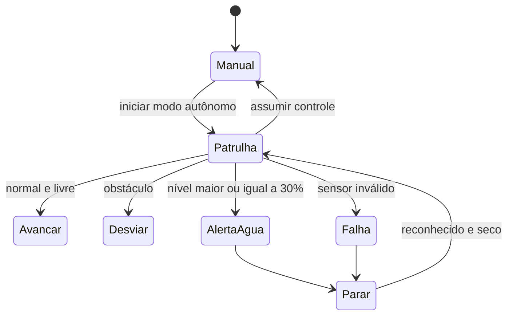

# Arquitetura de software

## Componentes

| Camada | Responsabilidade | Implementação |
|---|---|---|
| Aquisição | ler água e distância | ADC + pulso ultrassônico |
| Pré-processamento | filtrar e normalizar | média móvel e calibração |
| Inferência | estimar classe de risco | MLP TinyML em C++ |
| Segurança | garantir limites críticos | regras determinísticas |
| Controle | acionar movimento | GPIOs da L298N |
| Central | controle, telemetria e alertas | WebServer local |
| Persistência | manter calibração | Preferences/NVS |
| Coleta | formar dataset real | telemetria serial + Python |

## Máquina de decisão



## API local

| Método | Rota | Uso |
|---|---|---|
| GET | `/` | painel web |
| GET | `/api/status` | estado e telemetria em JSON |
| POST | `/mode/manual` | ativar modo manual |
| POST | `/mode/auto` | ativar modo autônomo |
| POST | `/alert/ack` | reconhecer o alerta de água |
| POST | `/move/forward` | avançar no modo manual |
| POST | `/move/reverse` | recuar no modo manual |
| POST | `/move/left` | girar à esquerda |
| POST | `/move/right` | girar à direita |
| POST | `/move/stop` | parar |
| POST | `/calibrate/dry` | salvar referência seca |
| POST | `/calibrate/wet` | salvar referência molhada |

## Evento de água na Central

O estado retornado por `/api/status` inclui:

- `water_present`: presença atual após histerese;
- `alert.active`: ocorrência pendente na Central;
- `alert.acknowledged`: confirmação do operador;
- `alert.events`: contador de ocorrências desde a inicialização;
- `alert.last_at_s`: instante do último evento;
- `alert.last_level`: maior nível observado na ocorrência.

O limiar de entrada é 30% e o de saída é 15%. Essa diferença evita que pequenas oscilações do ADC façam o alerta aparecer e desaparecer repetidamente. A referência molhada usada na calibração é ignorada como ocorrência até o sensor voltar ao seco.

## Telemetria

Uma linha por segundo é enviada na serial:

```text
telemetry,millis,adc,nivel,subida,distancia,obstaculo,risco
```

O coletor converte as variáveis em CSV rotulado. A classificação real é informada pelo operador durante cada execução do script.

## Escolhas técnicas

- GPIO 34 pertence ao ADC1 e não conflita com o Wi-Fi.
- Inferência local mantém o funcionamento sem internet.
- O cabeçalho gerado evita dependências externas no ESP32.
- A camada de segurança tem prioridade sobre a rede neural.
- A calibração persistente absorve variações entre unidades do sensor.
