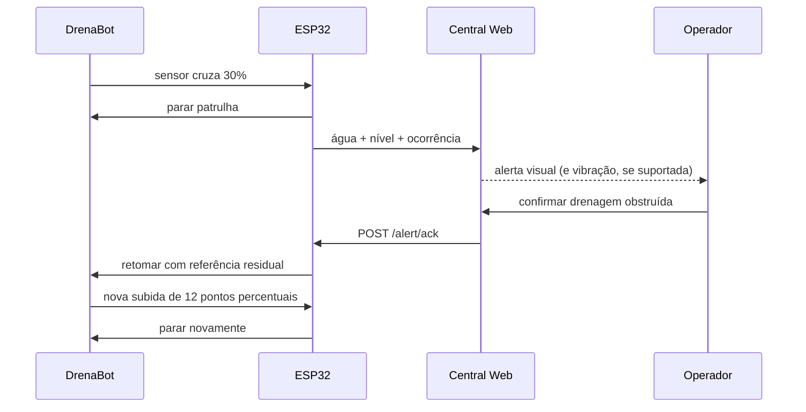

# Central DrenaHub

## Papel no MVP

A Central é a interface web hospedada no próprio ESP32. Ela simula o núcleo do aplicativo futuro sem acrescentar backend ou nuvem desnecessários à evolução do carrinho. O celular se conecta diretamente à rede do DrenaBot e recebe uma atualização de estado a cada 800 ms.

## Fluxo da ocorrência

## Informações apresentadas

- conexão do robô;
- modo manual ou patrulha autônoma;
- ação atual;
- confirmação antes do início da patrulha;
- parada de emergência sempre disponível;
- nível de água e valor ADC;
- distância frontal;
- classe e confiança TinyML;
- contador de ocorrências;
- último nível detectado;
- último evento operacional;
- referências de calibração.

## Regras simples

1. A água é detectada a partir de 30% do intervalo calibrado.
2. A ocorrência bloqueia o movimento até ser confirmada ou até a leitura ficar seca.
3. **Confirmar drenagem obstruída** fecha o alerta, libera o motor e transforma a leitura atual em referência residual.
4. Enquanto houver umidade residual, uma subida de 12 pontos percentuais gera uma nova ocorrência.
5. Abaixo de 15%, o sensor é considerado seco e volta à detecção normal de 30%.
6. Se a leitura residual estiver em 95% ou mais, a Central pede a secagem do sensor porque ele está saturado.
7. A condição molhada usada na calibração não conta como ocorrência.
8. A confirmação do modo autônomo força uma leitura atual dos sensores e já executa a primeira ação.
9. A parada de emergência muda o robô para manual e desliga os quatro sinais da ponte H.

## Limite do protótipo

O aviso é local e funciona enquanto a Central está aberta no celular conectado à rede do ESP32. Notificação remota, mapa, banco de dados e múltiplos robôs ficam como evolução de produto, não como dependência desta entrega de Maker Lab.
