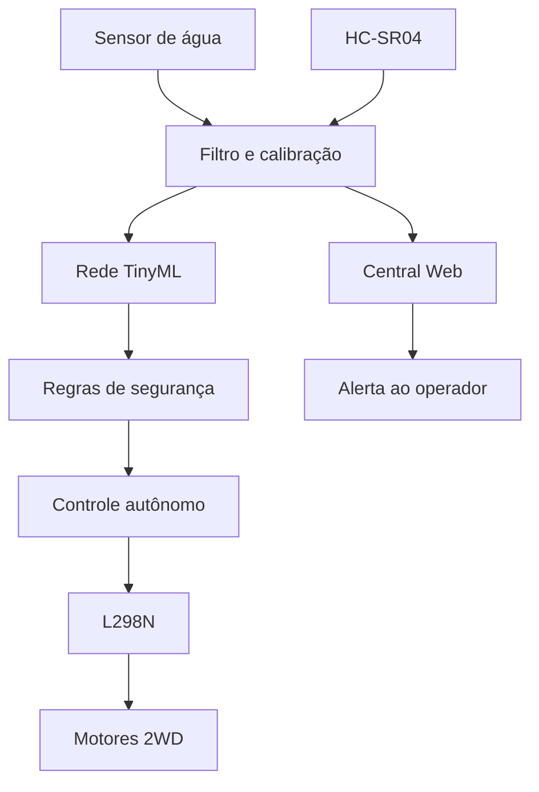

# Arquitetura do DrenaHub

## Visão geral

O DrenaBot 01 usa um único ESP32 como controlador, servidor web e dispositivo de inferência. O projeto reaproveita a base 2WD das etapas anteriores e adiciona o sensor analógico de água como novo elemento da Global Solution.

## Fluxo de dados

1. O sensor de água é lido pelo ADC1 do GPIO 34.
2. Uma média móvel de oito amostras reduz oscilações.
3. Os valores seco e molhado, salvos na memória, convertem o ADC em nível de 0 a 1.
4. A diferença entre leituras recentes gera a velocidade de subida.
5. O HC-SR04 mede distância; o firmware a transforma em risco de obstáculo.
6. A rede neural recebe as três variáveis e retorna as probabilidades de NORMAL, ATENÇÃO e CRÍTICO.
7. Regras determinísticas tratam falha de sensor, nível extremo e colisão iminente.
8. O modo autônomo decide avançar, parar ou executar manobra de afastamento.
9. Ao detectar água, o ESP32 registra a ocorrência e mantém o alerta na Central até o reconhecimento do operador.

## Modos de operação

| Modo | Objetivo | Comandos |
|---|---|---|
| Manual | posicionamento e teste | frente, ré, esquerda, direita e parar |
| Autônomo | patrulha e reação local | decisões da IA, parada e alerta de água |

A troca de modo ocorre no painel servido em `192.168.4.1`.

## Alimentação

- Power bank via USB: ESP32 e sensores.
- Quatro pilhas AA: entrada da L298N e motores.
- GND do ESP32 e da L298N: obrigatoriamente comum.

A separação reduz reinicializações causadas pela corrente de partida dos motores.

## Segurança funcional

A inferência não é a única proteção. O firmware prioriza parada segura quando:

- o HC-SR04 não retorna eco;
- o ADC satura;
- o nível calibrado chega a 75%;
- a distância chega a 10 cm;
- o sistema ainda não acumulou amostras suficientes.

O protótipo deve tocar somente uma esponja úmida ou bandeja rasa com a área sensível do sensor. A eletrônica não pode entrar na água.
