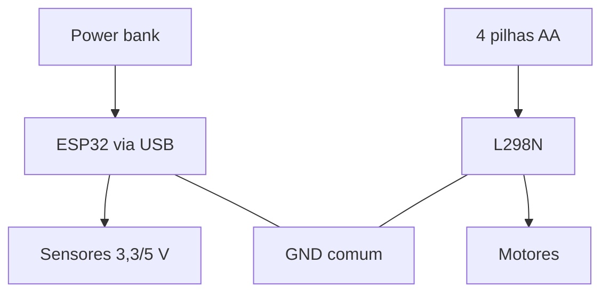

# Guia de ligações e montagem

## 1. Desligue todas as fontes

Faça as conexões com o power bank e o suporte de pilhas desconectados. Antes de energizar, confira se não existe curto entre 3V3 e GND.

## 2. Sensor de água — novo sensor

| Sensor | ESP32 |
|---|---|
| VCC / `+` | 3V3 |
| GND / `-` | GND |
| AO / `S` | GPIO 34 |

O GPIO 34 é ADC1 e pode ser usado enquanto o Wi-Fi está ativo. Alimente o sensor em 3,3 V para manter a saída dentro do limite do ESP32.

Monte a placa com os conectores voltados para cima e somente as trilhas sensíveis próximas do piso. Uma abraçadeira, fita dupla face forte ou o suporte CAD incluído pode fixá-la na lateral frontal do chassi.

## 3. HC-SR04

| HC-SR04 | ESP32 |
|---|---|
| VCC | 5V/VIN |
| GND | GND |
| TRIG | GPIO 18 |
| ECHO | divisor resistivo → GPIO 19 |

### Divisor do ECHO

```text
ECHO ── resistor 1 kΩ ──┬── GPIO 19
                         │
                    resistor 2 kΩ
                         │
                        GND
```

Não conecte o ECHO diretamente: ele pode trabalhar em 5 V e danificar a entrada de 3,3 V do ESP32.

## 4. Ponte H L298N e motores

| L298N | ESP32 / atuador |
|---|---|
| IN1 | GPIO 25 |
| IN2 | GPIO 26 |
| IN3 | GPIO 33 |
| IN4 | GPIO 32 |
| OUT1 / OUT2 | motor esquerdo |
| OUT3 / OUT4 | motor direito |
| GND | GND comum do ESP32 |

Mantenha os jumpers ENA e ENB. Se um lado girar ao contrário, troque entre si os dois fios daquele motor; não altere a pinagem inteira.

## 5. Alimentação



Não alimente os motores pelo pino do ESP32. A referência GND comum é necessária para que os sinais de controle sejam interpretados corretamente.

## 6. Teste por etapas

1. Sem motores e sem água, grave o firmware e confira no monitor serial se o ponto de acesso iniciou.
2. Conecte o celular à rede e abra o painel.
3. Verifique se a distância muda ao aproximar um objeto.
4. Verifique se o ADC muda ao tocar a área sensível com uma esponja úmida.
5. Faça a calibração seco/molhado.
6. Com as rodas suspensas, teste manualmente frente, ré e giros.
7. Coloque o robô no piso seco e teste o modo autônomo.
8. Por último, aproxime o sensor de uma bandeja rasa; não conduza o chassi para dentro da água.

## 7. Valores esperados

Os valores exatos variam por sensor. O importante é que:

- a leitura seca seja estável;
- a leitura molhada seja pelo menos 100 pontos maior que a seca;
- o painel mostre aproximadamente 0% no seco e 100% na referência molhada;
- o HC-SR04 mostre distância positiva e coerente.

Se a leitura diminuir quando molha, o modelo de sensor é invertido. Nesse caso, não prossiga com a demonstração antes de adaptar a normalização no firmware.
